# Synchronized gait capture



This runnable example illustrates how camera frames and motion samples can refer to the same instant in a stride. It accompanies an elder care home fall-detection research project at Toronto Rehab (UHN). The public implementation was written for this demonstration. It generates its own poses and timestamps. The clinical capture software, resident recordings and fall-detection model are outside this release.

## Run it

Python 3.9 or later is sufficient. From the repository root run

```sh
python sync.py
python render.py
python -m unittest -v
```

[Download the source ZIP](https://github.com/R-M77/gait-capture-demo/archive/refs/heads/main.zip) or clone the repository. The [MIT license](LICENSE) covers the code and generated diagrams.

## Use the timing example

[`sync.py`](sync.py) pairs each camera exposure with the nearest motion sample after both clocks have been expressed relative to the same hardware trigger. It reports a missing match when the nearest sample falls outside the tolerance. Equal-distance ties select the earlier sample. Independent device clocks need calibration before using this function.

```python
from sync import match_frames

# Common trigger at zero. All timestamps and the tolerance are microseconds.
list(match_frames([0, 9_900, 20_100], [0, 10_000], tolerance=500))
# [(0, 0), (9900, 1), (20100, None)]   Each pair gives the frame time and motion index.
```

Running the script prints four illustrative camera exposures against a synthetic 100 Hz signal. Redirect stdout to save the CSV. These rates and the plotted joint angle are choices for the demonstration. The original project's sensor rates and placement are not specified here.

## How the stride was checked

[`gait.py`](gait.py) solves a two-link leg in side view. The supporting sole stays on the ground for the first 60% of the cycle. The legs alternate half a cycle apart. The knee bends during loading, extends during stance, bends to about 62° in swing, and extends again before the next heel strike. The silhouette, camera samples, and knee trace all use this function. Four thumbnails sample a one-second synthetic stride at quarter intervals. Playback stretches the stride to 1.8 seconds for inspection.

The phase and peak were chosen against published walking measurements. Table 1 reports a mean stance duration of 60.7% at a comfortable walking speed. Figure 1 describes a representative swing-phase knee peak of about 60°. These are reference landmarks for ordinary level walking. The illustration does not estimate individual gait, identify a fall, or establish clinical accuracy. [Walking kinematics study, Table 1 and Figure 1](https://pmc.ncbi.nlm.nih.gov/articles/PMC1866234/)

[`test_gait.py`](test_gait.py) checks stance contact, swing clearance, joint geometry, left/right timing, knee-angle landmarks, frame timing, trace values, and reproducibility of all four SVGs. It also checks timestamp ties, missing samples, and out-of-tolerance frames. All checks run on synthetic inputs.
